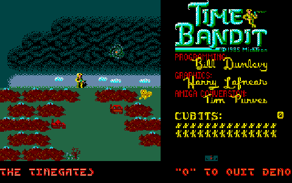
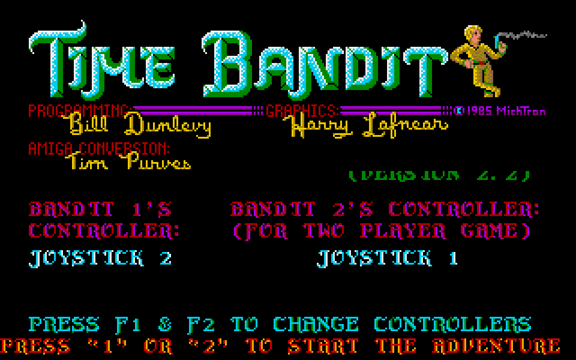
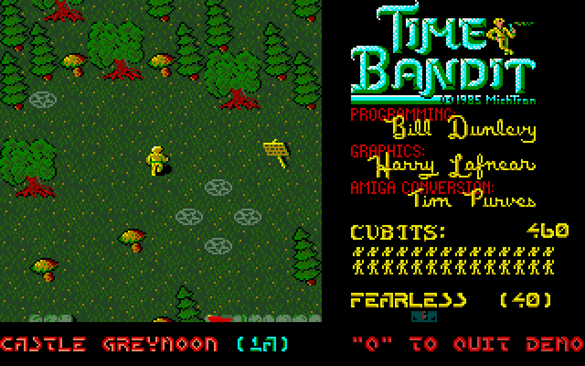
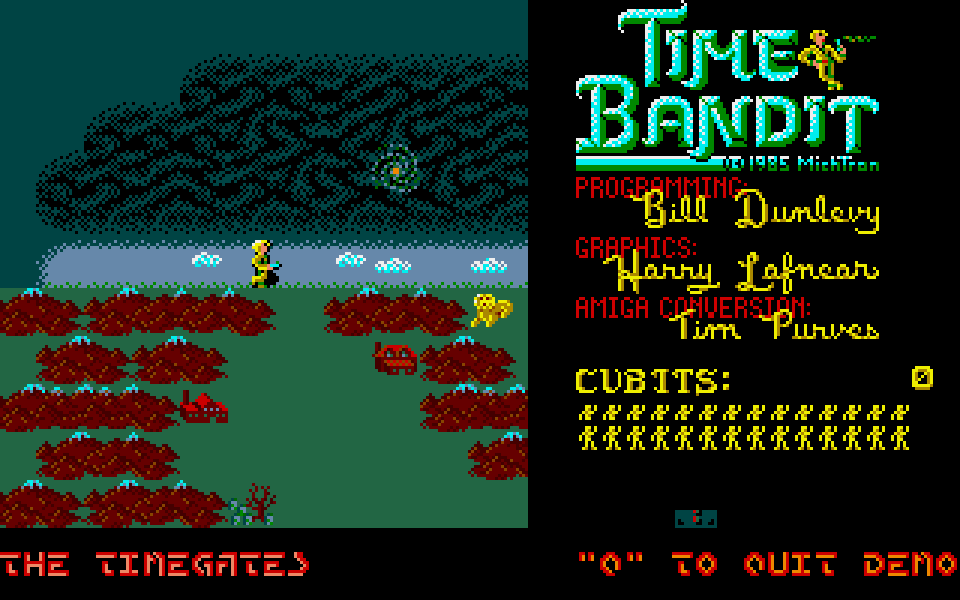
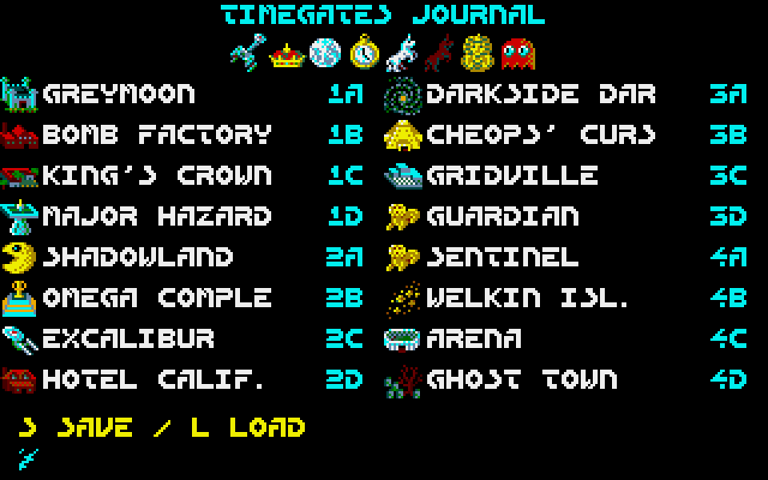
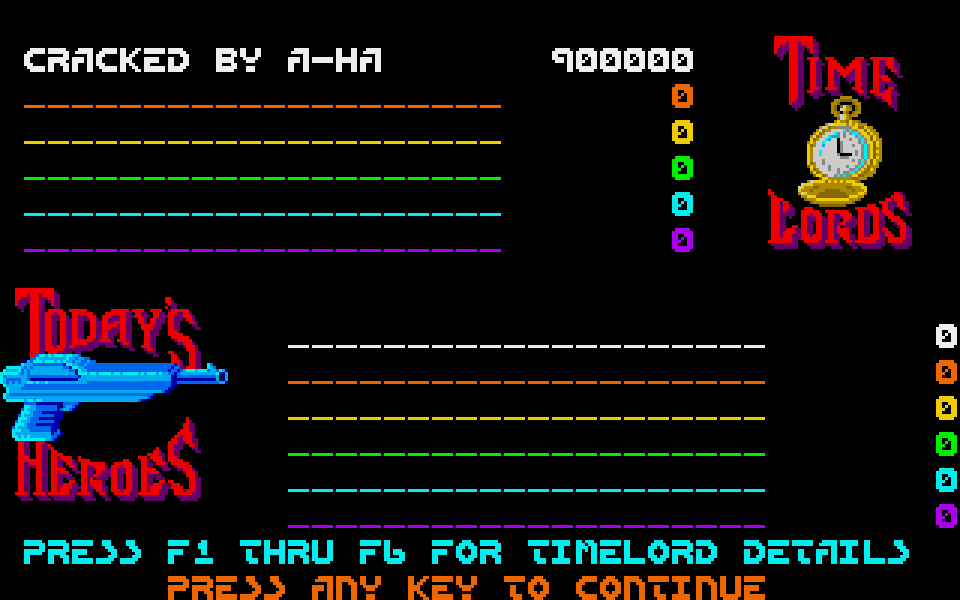
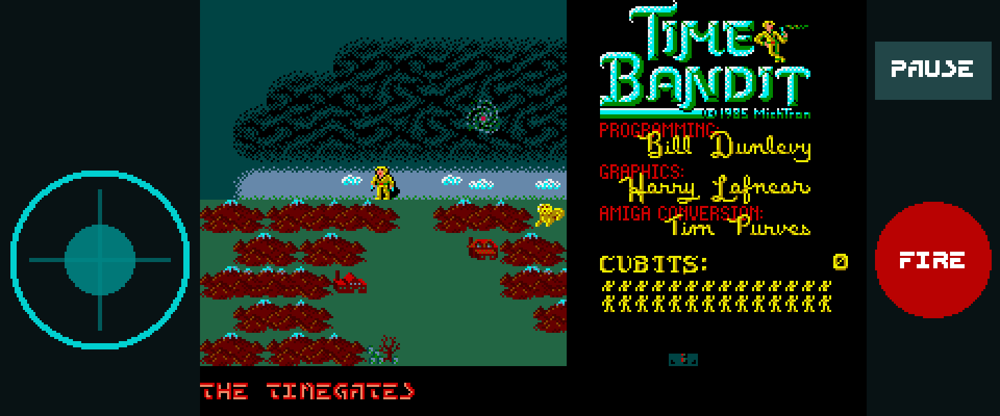

# Time Bandits Go

A native Go/Ebitengine remake of **Time Bandit v2.2** for desktop and Android.
Explore all 17 worlds and their 16 phases, collect keys, survive the monsters
and return to the Timegates hub. The game includes one-player and simultaneous
two-player modes, text adventures, performance ratings, the journal and
persistent Timelord records.



[Watch the full presentation video](media/timebandits-demo.mp4) ·
[WebM version](media/timebandits-demo.webm)

## Desktop

Go 1.26 or newer and a desktop graphics environment are required.
The runtime assets are included; no preparation step is needed to play.

```sh
go run .
```

Build and run a standalone executable:

```sh
make build
./bin/timebandits
```

Useful launch options:

```sh
go run . -fullscreen # Start in fullscreen mode.
go run . -demo       # Start the automatic demonstration.
go run . -players 2  # Start a simultaneous two-player game.
go run . -touch      # Preview the Android touch layout.
go run . -mute       # Disable audio.
go run . -scale 4    # Select an initial window scale from 1 to 8.
```

The game preserves the original 320 × 200 image, animated palettes and
20 Hz gameplay cadence, with nearest-neighbor scaling. An idle title screen
starts a demonstration after 15 seconds.

## Controls

| Input | Action |
| --- | --- |
| 1 / Enter / Z | Start a one-player game |
| 2 | Start a simultaneous two-player game |
| Arrow keys or WASD | Move Bandit One |
| Space or Z | Fire |
| I, J, K, L | Move Bandit Two |
| O | Fire for Bandit Two |
| P | Pause or resume |
| H | Open the Timelords and Today's Heroes records |
| F1 / F2 | Cycle the original controller choices on the title screen |
| Letter keys, Backspace, Enter | Answer text-adventure prompts |
| S / L in the Timegates journal | Save or load one of two persistent buffers |
| Escape | Pause, then return to the title |
| Q | Leave the automatic demonstration |
| Gamepad | D-pad or stick to move, primary button to fire |

## Android

The Android build requires Go 1.26+, Java 17 or 21, Android SDK 36,
Android Build Tools 36.0.0 and Android NDK 28.2.13676358. Set `ANDROID_HOME`
or `ANDROID_SDK_ROOT` when the SDK is not installed in a standard location.

Build the ARM64 debug APK:

```sh
make android
```

Build, install and launch on one authorized USB device:

```sh
make android-run
```

The APK is written to:

```text
android/app/build/outputs/apk/debug/app-debug.apk
```

The landscape layout keeps the original game image intact, with a movement
stick on the left and Fire and Pause on the right. Text-adventure prompts
provide a touch keyboard. Returning from the background pauses the game.

## Screenshots

| Original title | Gameplay |
| --- | --- |
|  |  |

| Timegates hub | Timegates journal |
| --- | --- |
|  |  |

| Timelord records | Android touch controls |
| --- | --- |
|  |  |

## Original game credits

The original credits name **Bill Dunlevy** for programming, **Harry Lafnear**
for graphics, **Tim Purves** for the Amiga conversion, and **MichTron /
Microdeal** as publisher. Time Bandit, its name, artwork, game data and audio
remain the property of their respective rights holders. This independent
preservation port is not affiliated with or endorsed by them.

No Amiga disk image is distributed in this repository. See [ADF.md](ADF.md)
for the reference version used by the project.
